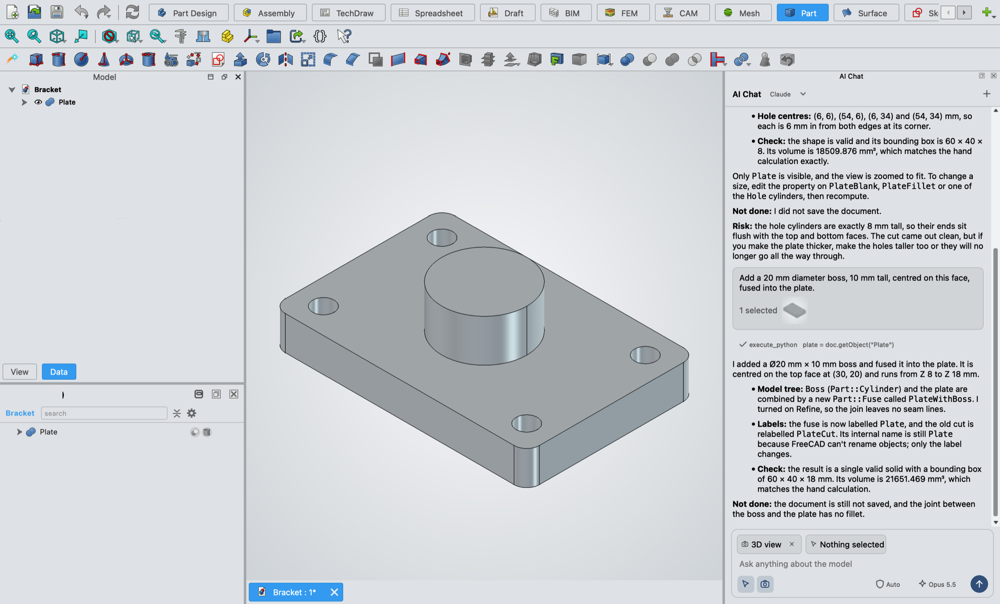
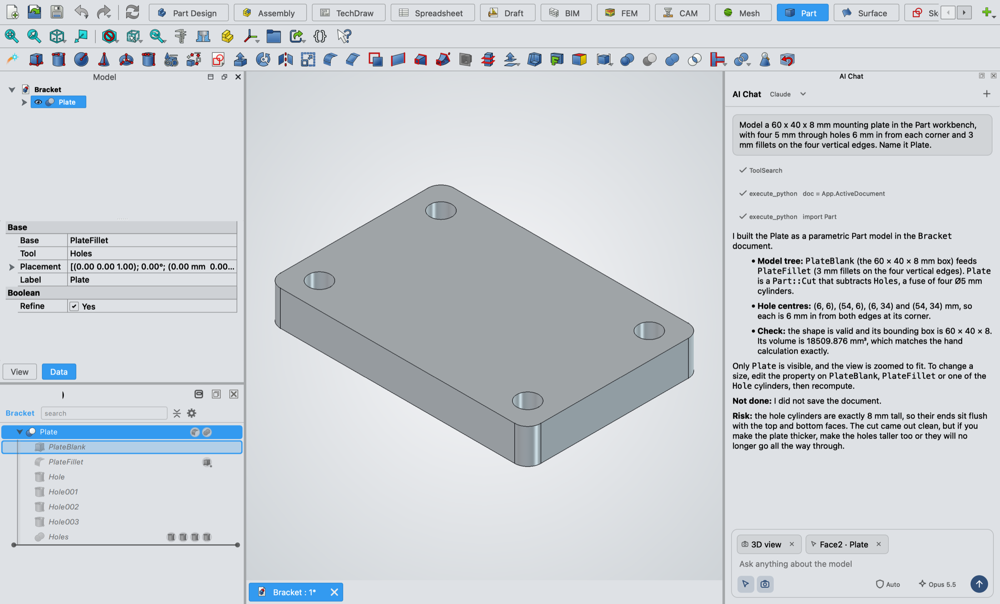
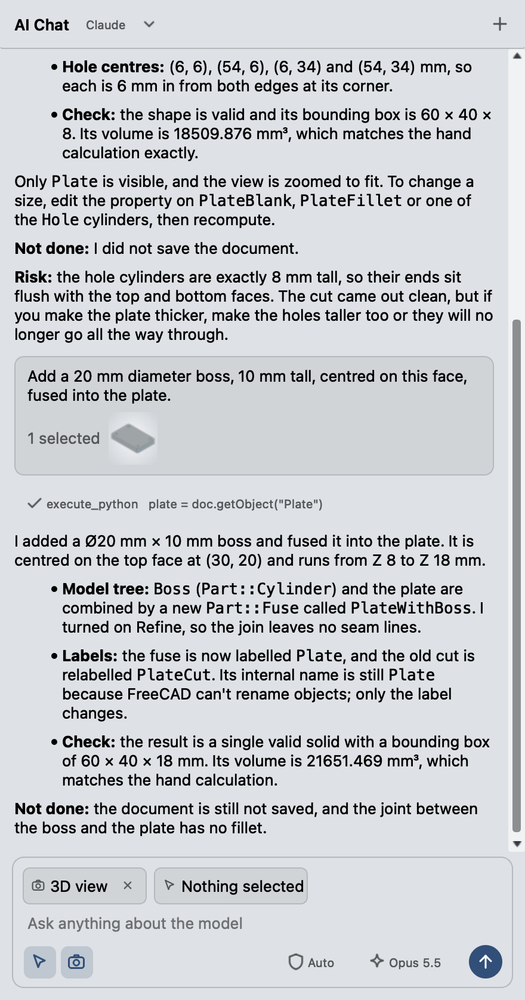
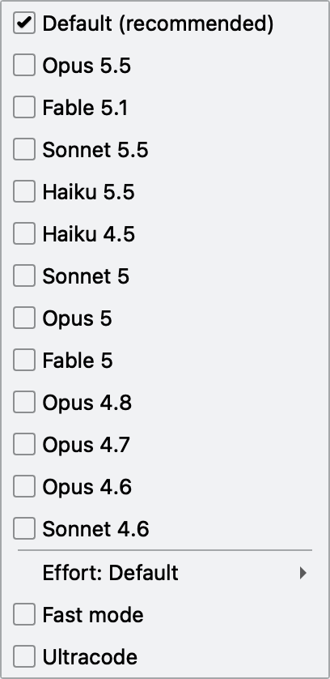
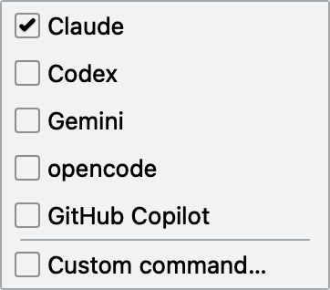

<div align="center">


# freecad-ai

**Chat with Claude, Codex, Gemini or any ACP agent inside FreeCAD, and let it model in your open document.**

[](https://github.com/TheGoatedDev/freecad-ai/actions/workflows/ci.yml) [](https://www.freecad.org) [](https://agentclientprotocol.com) [](#install) [](LICENSE)

[Install](#install) · [Usage](#usage) · [Providers](#providers) · [How it works](#how-it-works) · [Security](#security) · [Development](#development)

</div>

<br>



freecad-ai adds an **AI Chat** panel to FreeCAD. You type what you want, the agent writes and runs FreeCAD Python in your live session, and the result appears in the 3D view and model tree like anything you built by hand. The plate above came from two prompts: one for the plate, holes and fillets, and one for the boss on the face that was selected.

- **Any ACP agent.** Claude, Codex, Gemini, opencode and GitHub Copilot are one click apart, and a custom command runs anything else that speaks the [Agent Client Protocol](https://agentclientprotocol.com).
- **Point at geometry.** Select faces, edges or vertices and they go with your message: surface type, area, centroid, normal or radius, and pick point.
- **Show the agent the view.** A toggle sends a picture of the 3D view with each message.
- **Model, effort and fast mode.** Pick them from the panel. Choices carry over to new chats.
- **Permissions in the chat.** Approval requests appear inline, and a mode picker sets how often the agent asks.
- **Follows your theme.** Colours come from the FreeCAD theme you have loaded.
- **Nothing to install.** Pure Python on FreeCAD's own interpreter. The default agents run through `npx`.

> [!WARNING]
> The agent runs Python inside FreeCAD with your user's permissions. It can change or delete objects, and FreeCAD's Python can read and write files. Save your work before long sessions, and pick **Manual** in the permission menu if you want to approve each step.

## Install

You need FreeCAD 1.1 or newer and [Node.js](https://nodejs.org) for `npx`.

1. Find your FreeCAD user folder. In FreeCAD, open **View > Panels > Python console** and run `App.getUserAppDataDir()`.
2. Clone this repo into the `Mod` folder inside it:

   ```sh
   cd "<user folder>/Mod"
   git clone https://github.com/TheGoatedDev/freecad-ai.git
   ```

3. Restart FreeCAD.
4. Sign in to the agent you want to use, for example run `claude` once for Claude.

## Usage

Switch to any workbench and click **AI Chat** on the toolbar. The panel opens on the right and starts the agent. If the toolbar is hidden, turn it on under **View > Toolbars > AI Chat**.



Under the message box:

- The **pointer** toggle sends your current selection. Chips show what is selected right now. Click a chip's x to deselect it.
- The **camera** toggle sends a picture of the 3D view.
- The **shield** menu picks the permission mode: Manual, Accept edits, Plan, Auto or Bypass permissions.
- The **model** menu picks the model and effort, and turns fast mode on or off. A blue bolt means fast mode is on.

Both toggles are read when you press send, so select first, then send. **Enter** sends, **Shift+Enter** starts a new line. Click a tool row to see the code the agent ran and its output.

<table>
  <tr>
    <td width="50%"></td>
    <td width="25%"></td>
    <td width="25%"></td>
  </tr>
</table>

## Providers

The menu next to the title switches the agent and starts a new chat.

| Provider | Command |
| --- | --- |
| Claude | `npx -y @agentclientprotocol/claude-agent-acp` |
| Codex | `npx -y @agentclientprotocol/codex-acp` |
| Gemini | `npx -y @google/gemini-cli --acp` |
| opencode | `npx -y opencode-ai acp` |
| GitHub Copilot | `npx -y @github/copilot --acp` |
| Custom | any shell command that starts an ACP agent on stdio |

If an agent needs you to sign in, the chat shows its sign-in options. The model, effort and permission menus list whatever the agent offers, so they differ between providers.

## How it works

```text
 FreeCAD (one process)                                   agent subprocess
┌──────────────────────────────────────────────┐       ┌──────────────────────┐
│ AI Chat panel ── ACP client ───── stdio ─────┼──────►│ claude-agent-acp,    │
│      ▲            (JSON-RPC)                 │       │ codex-acp, gemini... │
│      │                                       │       └──────────┬───────────┘
│ selection, view                              │                  │ MCP over HTTP
│                                              │                  │ 127.0.0.1, bearer token
│ MCP server ◄─────────────────────────────────┼──────────────────┘
│   execute_python ──► runs on the GUI thread  │
│                      (App, Gui preloaded)    │
└──────────────────────────────────────────────┘
```

The panel starts the agent with your login shell so `npx` is on the path, and talks ACP to it over stdin and stdout. On each new session it hands the agent one MCP server: a small HTTP server inside FreeCAD with a single `execute_python` tool. That server listens on `127.0.0.1` on a random port and rejects requests without a token generated for that FreeCAD session. Tool calls run on FreeCAD's GUI thread, because FreeCAD's API is not thread-safe.

## Security

- The MCP server only listens on loopback and needs a fresh random bearer token per FreeCAD session, so other local programs cannot run code through it.
- The agent can still do anything FreeCAD's Python can do. The permission mode decides how often it asks first.
- Selections and view pictures are sent to the agent's provider with your message, only while their toggles are on.

## Settings

Click the sliders button in the panel header, or open **Edit > Preferences > AI Chat**, to set the **working folder**. The agent starts in that folder, so it reads any `CLAUDE.md` or `AGENTS.md` you keep there. Use these files for standing instructions such as units, naming rules or which workbench to use. If the field is empty, the agent starts in the open document's folder, or in your home folder if there is none. A changed folder applies to the next new chat.

The rest of the settings are under **Tools > Edit parameters**, in `BaseApp/Preferences/Mod/ACPChat`:

| Key | Meaning |
| --- | --- |
| `AgentCommand` | Shell command for the current provider |
| `WorkingFolder` | Folder the agent starts in. Empty means the open document's folder |
| `IncludeSelection`, `IncludeView` | Toggle states |
| `Config_<id>` | Last chosen value for each agent option, such as `Config_model` |

## Development

Tooling runs through [uv](https://docs.astral.sh/uv/). The addon itself has no dependencies; `uv sync` installs only the dev tools.

```sh
uv sync
uv run ruff check .
uv run ruff format .
uv run mypy
uv run python -m unittest discover tests
```

Turn on the git hooks once per clone:

```sh
git config core.hooksPath .githooks
```

`pre-commit` runs ruff. `pre-push` runs mypy and the tests. CI runs all of them on every push to `main` and every pull request.

mypy runs in strict mode. It skips `FreeCAD`, `FreeCADGui` and `PySide`, which only exist inside FreeCAD. The unit tests cover the ACP client and the MCP server without FreeCAD. The panel itself was tested by driving FreeCAD on macOS. Linux and Windows are untested.

## License

[MIT](LICENSE)
